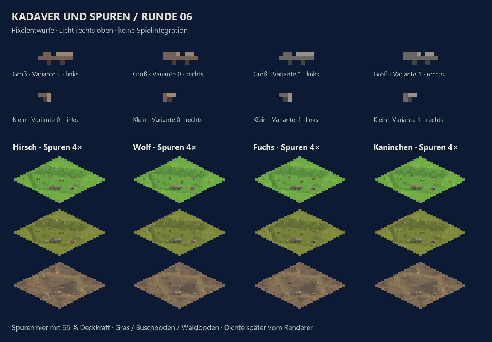
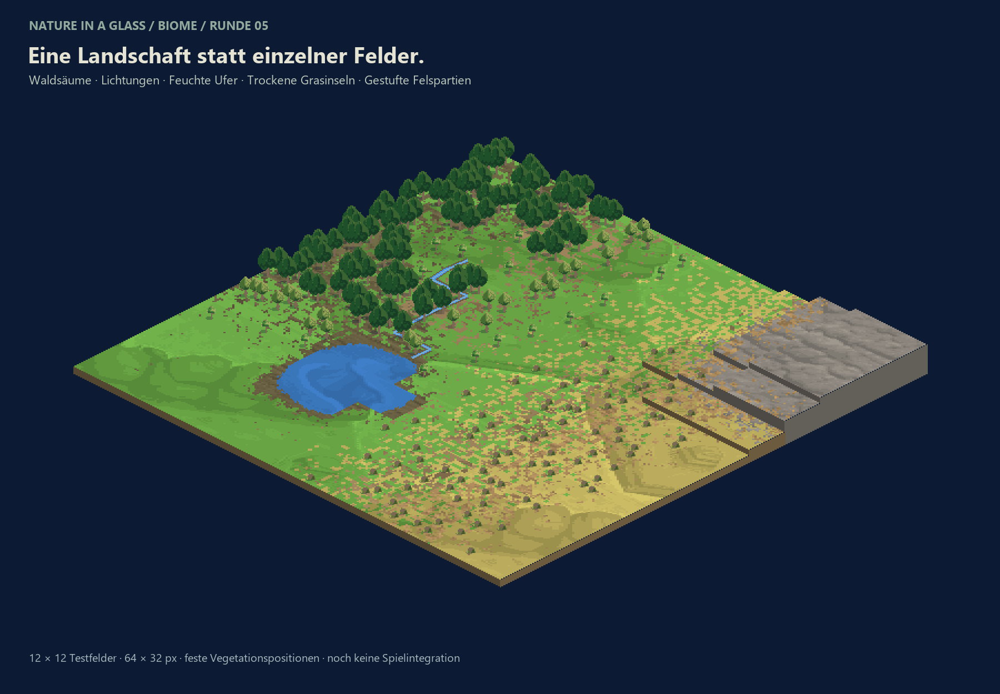
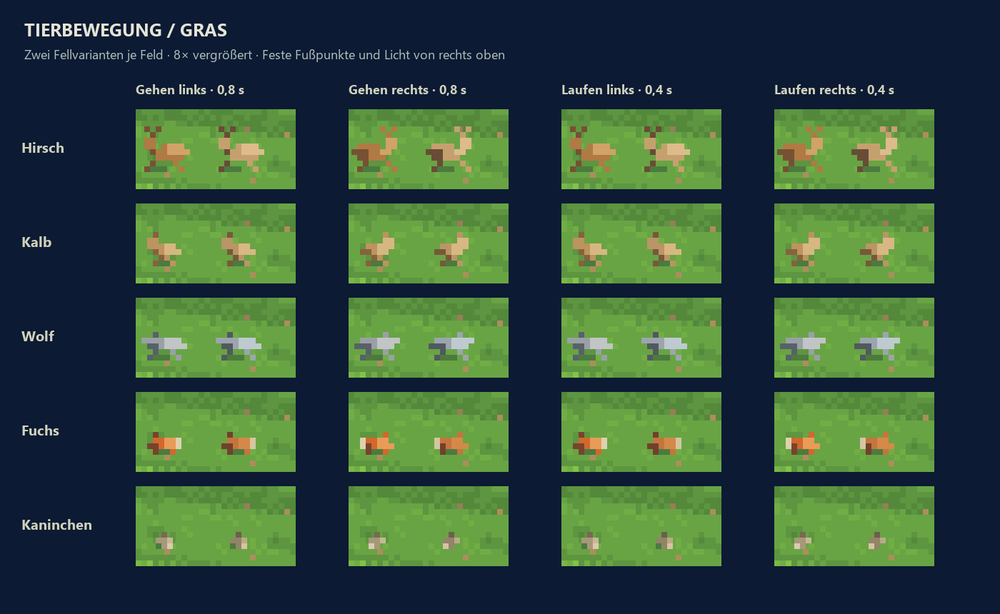
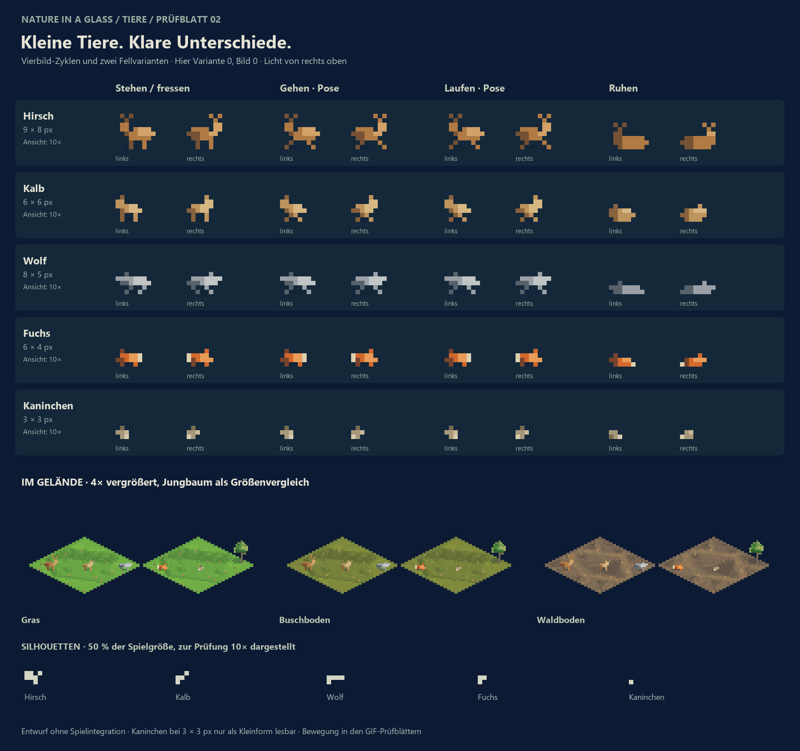
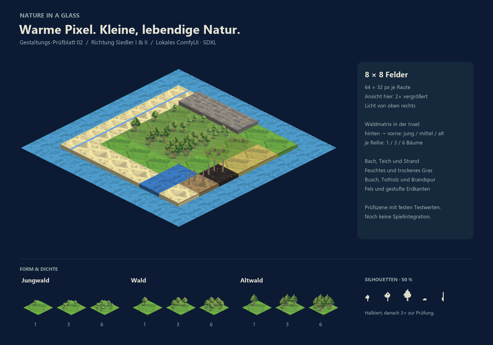
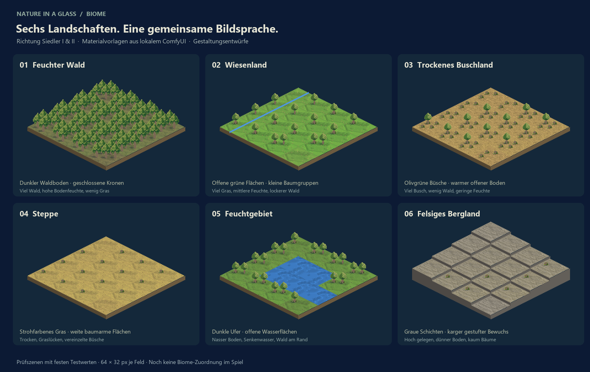

# Naturgestaltung – Prüfblatt 01

**Aktuell ist Runde 06:** Kadaver und Spuren, siehe `ROUND-06.md`.
Ausgearbeitete Biome und Übergänge stehen in `ROUND-05.md`.
Tieranimationen und zweite Fellvariante stehen in `ROUND-04.md`.
Die Naturkorrekturen der vorigen Runde stehen in `ROUND-03.md`.
Die zweite Stilrunde ist in `REVISION-02.md` dokumentiert. Die folgende Beschreibung
dokumentiert die erste Runde; deren Bilder sind unter `proof-01/` gesichert.
Manifest und Testbelegung der ersten Runde sind mit `assets/nature/` identisch
und liegen deshalb nur dort.

## Aktuelle Entwürfe

### Kadaver und Spuren – Runde 06



[Umfang, Prüfung und Einbindung](ROUND-06.md)

### Biome und Übergänge – Runde 05



[Sechs ausgearbeitete Biome](../../assets/nature/_biomes-refined.png)
· [Herstellung und Grenzen](ROUND-05.md)

### Tierbewegung – Runde 04



[Auf Buschboden](../../assets/nature/_animals-motion-shrub.gif)
· [Auf Waldboden](../../assets/nature/_animals-motion-forest.gif)
· [Phasenvergleich](../../assets/nature/_animals-frames.png)
· [Herstellung und Prüfung](ROUND-04.md)

### Tiere und Naturkorrekturen – Runde 03



[Fressbilder als Animation](../../assets/nature/_animals-graze.gif)
· [Umfang, Herstellung und offene Prüfpunkte](ROUND-03.md)

### Stilrichtung 2 – Siedler I & II



[Vergleich mit der ersten Fassung](../../assets/nature/_comparison-v2.png)
· [Herstellung und Prüfung](REVISION-02.md)

### Unterschiedliche Biome



[Herstellung und Prüfbelegungen](BIOMES.md)

Beide Blätter sind Gestaltungsentwürfe. Die Assets sind noch nicht in den
Spielrenderer eingebunden.

Stand: 17.10.2026. Grundlage: `docs/gestaltung.md`, Fassung 0.2,
Repository-Stand `efebd519363dca9a3d2173f7d0916e30427de37b`.

## Ergebnis und nächster Schritt

`assets/nature/_testsheet.png` ist der erste Entwurf zur gestalterischen Abnahme
nach Abschnitt 10. Das Blatt zeigt eine 8×8-Prüfinsel, eine separate Dichtematrix
und verkleinerte Silhouetten. `assets/nature/_island.png` enthält die Insel ohne
Beschriftung in Originalgröße. Die Darstellung auf dem Prüfblatt ist 2× vergrößert.

Die Szene verwendet feste Testbelegungen aus `assets/nature/proof-layout.json`;
sie ist kein Screenshot eines laufenden Simulationsstands. In der Insel stehen
jeweils 1, 3 und 6 Bäume aller drei Altersstufen. Hinzu kommen Buschland, Totholz,
Brandboden, Fels, Sand, trockene und feuchte Grasflächen, ein Bach und ein Teich.

Die 20 PNGs und das Manifest unter `assets/nature/` sind **Prototypen für dieses
Prüfblatt**, kein vollständig abgenommenes Produktionspaket. Nach Bestätigung
der Richtung folgen die vollständigen Varianten, Wasseranimationen,
Stresszustände, liegendes und verkohltes Totholz, Feuer und Herbstzustände gemäß
der Reihenfolge in der Gestaltungsvorlage. Eine technische Renderer-Einbindung
ist ausdrücklich ein späterer Schritt mit eigenem ADR.

## Erzeugung auf diesem Rechner

- Lokales ComfyUI auf `127.0.0.1:8188`, NVIDIA GeForce RTX 3070 Ti (8 GB).
- Modell: `sd_xl_base_1.0.safetensors` aus der vorhandenen Installation.
- Zehn Vorlagen, jeweils 768×768 px, 24 Schritte, CFG 6,5, DPM++ 2M / Karras.
- Seeds: 2026101700 bis 2026101709.
- `comfyui/*.api.json`: vollständige API-Workflows mit positiven und negativen Prompts.
- `comfyui/*.history.json`: tatsächliche Ausführungsprotokolle und Prompt-IDs.
- `comfyui/*.png`: unveränderte erzeugte Vorlagen.
- `comfyui/system-stats.json`: nur lokal gespeicherte Versions- und Geräteinformationen des Dienstes (nicht versioniert).

SDXL erzeugte trotz Einzelmotiv-Prompts teilweise Motivbögen. Deshalb wurden
passende Einzelmotive nach Sichtprüfung ausgewählt, freigestellt und auf die
Zielmaße reduziert. Die konkrete Ausschnittwahl und Pixelbereinigung stehen in
`tools/nature/build_proof.py`. Die Verarbeitung verwendet Pillow und NumPy:
Rautenmasken, maximal sechs Farben je Asset, harte Außenkanten, 30-prozentige
Schlagschatten links unten sowie durchgehende Stammfüße. Die Texturen wurden
kontrastarm auf die vorgeschriebenen Ankerfarben umgefärbt. Sand, Graszustände
und Waldboden teilen sich für den ersten Stiltest entsprechende Materialvorlagen.

## Nachvollziehbar erneut erstellen

Im Repository-Ordner mit dem Python der vorhandenen ComfyUI-Umgebung:

```powershell
& 'L:\Comfy-Desktop\ComfyUI-Installs\ComfyUI\ComfyUI\.venv\Scripts\python.exe' tools\nature\generate_sources.py
& 'L:\Comfy-Desktop\ComfyUI-Installs\ComfyUI\ComfyUI\.venv\Scripts\python.exe' tools\nature\build_proof.py
```

Der erste Aufruf benötigt einen laufenden ComfyUI-Dienst und überspringt bereits
gesicherte Vorlagen. Der zweite baut das Prüfblatt ausschließlich aus den
gesicherten Vorlagen neu. Gleiche Seeds allein garantieren bei geänderter
GPU-/ComfyUI-/PyTorch-Version keine pixelgleichen KI-Ergebnisse; deshalb sind die
Originalbilder mit abgelegt.

## Prüfung

`assets/nature/validation.json` protokolliert für alle 20 Assets exakte Maße,
RGBA-Modus, eingebettetes sRGB-Profil, die Farbanzahl und verwendete Alpha-Werte.
Die Vegetation verwendet nur vollständig deckende Pixel und den eigenen
Schlagschatten mit Alpha 77. Rauten sind außen transparent. Die Wandstreifen
haben identische obere und untere Pixelzeilen für vertikale Wiederholung.

Das Prüfblatt wurde visuell kontrolliert und überarbeitet: Materialkontrast
reduziert, fremde Motivreste entfernt, Stammfüße verbunden und Teich ergänzt.
Die Silhouetten werden zunächst auf 50 Prozent reduziert und dann zur lesbaren
Darstellung im Blatt 3× vergrößert.

Noch nicht abgenommen sind die künstlerische Richtung, die endgültigen
Materialübergänge zwischen allen Varianten und die spätere Darstellung im
Spielrenderer. Animationsgrenzen werden erst mit den Animationsgruppen geprüft;
die jetzigen Wasserbilder sind bewusst statische Prototypen.
