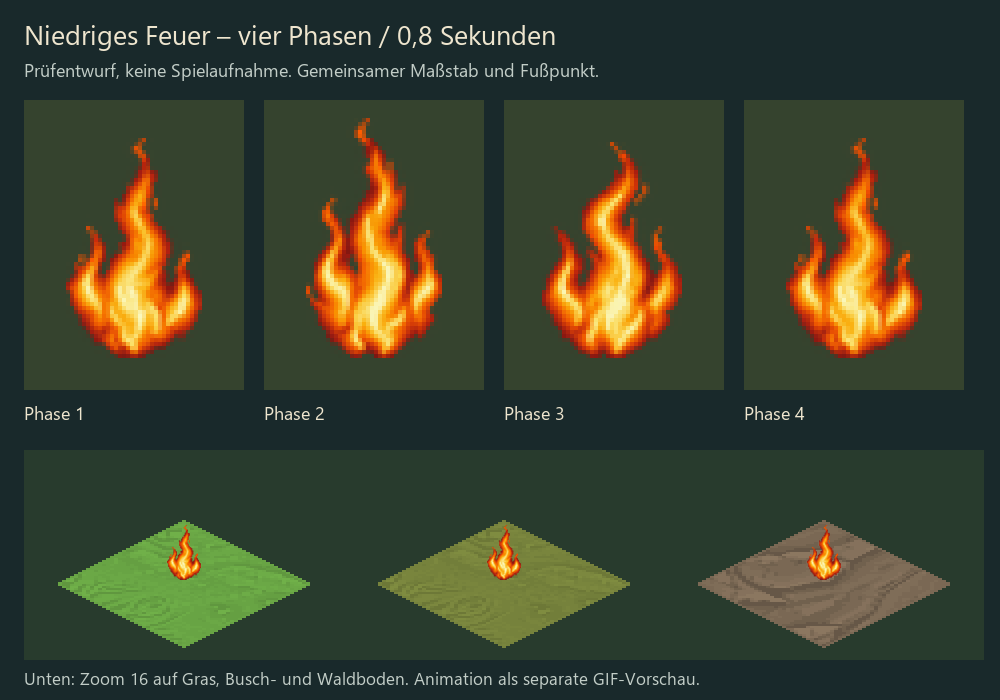
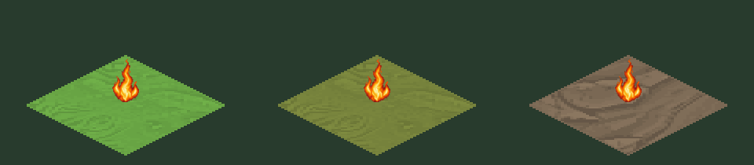

# Niedriges Feuer – Prüfentwurf vom 26.10.2026

Erster Teil von Aufgabe 2, Gruppe E aus `docs/gestaltung.md`. Vier eigens
generierte Phasen von `fire_flame_small`, keine Änderung eingebauter Assets.

**Ergänzung:** Großes Feuer, Glutsaum und Rauch sind inzwischen ebenfalls als
Prüfentwürfe vorhanden. Aktueller Gesamtstand und Grenzen: [Feuerpaket](PACKAGE.md).

- Vier PNG RGBA8, jeweils 40×64 (vierfache Auflösung von 10×16).
- Fußpunkt [20,62], Weltmaß [10,16]. Gemeinsamer Skalierungsfaktor für alle
  vier generierten Zellen; unten ausgerichtet, nicht je Phase aufgeblasen.
- 200 ms pro Phase, Schleife 800 ms. Manifest hält diese Absicht fest;
  das ist noch keine vom Renderer implementierte Zeitsteuerung.
- Alpha bleibt erhalten. Helligkeit: Summe der mit Alpha gewichteten
  Rec.709-Luma-Codewerte; (Maximum−Minimum)/Minimum = 17,17 %, unter 25 %.
  Diese technische Messung ersetzt keine Wahrnehmungsprüfung der Animation.
- Die Einzelphasen wurden im Prüfblatt angesehen. Spielprüfung und Freigabe
  stehen aus. GIF ist eine synthetische Vorschau auf drei Böden bei Zoom 16.

## An Claude

`appearance::sprites` liefert `fire_flame_small` bzw. `fire_flame_large` mit
Zustand `normal`, aber der Ordner `fire` wird aktuell nicht eingebettet.
Bitte Ablage, Namensauflösung, Framewahl und Zeichenreihenfolge abstimmen,
bevor diese Bilder in `assets/` übernommen werden. Die Dateinamen folgen
hier dem allgemeinen Schema aus Abschnitt 9: `fire_flame_small_0_f0…f3.png`.
Das Paket ist keine Zusage, dass `--bilder` allein bereits animiertes Feuer
anzeigen kann. Keine Änderungen an Kern, Renderer oder Build-Skript.

Noch offen in Gruppe E: Prüfung bei weiterem Zoom, echte Spielaufnahme,
Überarbeitung/Abnahme des Rauchstils und gestalterische Freigabe. Der
vorherige Fuchs-Entwurf aus PR #9 bleibt unabhängig hiervon zur Prüfung.

## Herstellung

Eingebautes image_gen, ein Auftrag für vier Phasen derselben Flamme. Prompt
in `prompt.txt`, Quellhash und technische Messung in `validation.json`.
Rohausgabe lokal unter `runs/fire-source/generated.png`, nicht im Repository.
Technischer Export: `python tools/nature/build_fire_review.py <Quelle>`.
Das Skript verweigert ein vorhandenes Zielverzeichnis. Bibliothek: Pillow;
Prüfblatt verwendet Segoe UI unter Windows. Kein lokaler ComfyUI-Erfolg
behauptet, keine neue Infrastruktur installiert.
