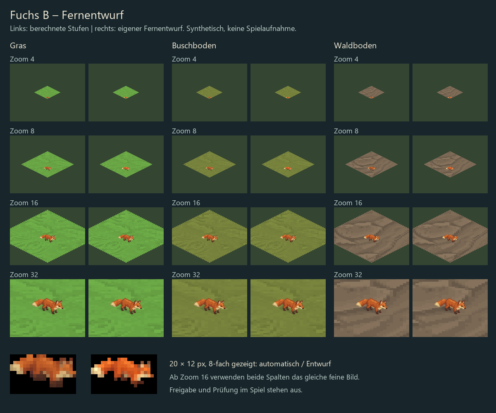

# Fuchs B: eigener Fernentwurf, 19.10.2026

**Prüfentwurf, nicht freigegeben oder eingebaut.** Ein rechtes Fress-/Standbild
als erster Vergleich. Keine linke Ansicht, keine neuen Bewegungsbilder.



Der eingebaute Bildgenerator hat anhand der bestätigten Stil-B-Referenz einen
vereinfachten Fuchs erzeugt. Größere helle Flächen an Schwanz und Schnauze,
getrennte dunkle Beine, weniger Binnenstruktur. Die lokale ComfyUI-Pipeline
wurde nicht erneut getestet; ihre bekannten Qualitätsgrenzen bleiben bestehen.
Dies ist kein Nachweis einer vollautomatisch erfolgreichen Sprite-Produktion.

## Ergebnis

- RGBA-PNG 20 × 12, transparenter Hintergrund, Fußpunkt [10,10].
- Hauptbild bleibt die bestehende Stil-B-Referenz in `../fox-ab/` (80 × 48,
  Fußpunkt [40,40], Leinwand-Weltmaß [10,6]). Keine Dateidoppelung im Repository.
- Entwurf belegt 19 Pixel Breite, entsprechend 9,5 Welteinheiten: Das ist die
  angenäherte sichtbare Breite der bestehenden Referenz, nicht die Kalibrierung
  des separat abgelehnten ComfyUI-Piloten. Hauptbild und Fernstufe teilen ihr Maß.
- Kontaktbogen zeigt Gras, Busch- und Waldboden bei Zoom 4,8,16,32. Links
  berechnete Stufen nach `atlas.rs::halve` v0.7.4, rechts mit Fernentwurf.
  Das ist eine Python-Vorschau und **keine Spielaufnahme**. Ab Zoom 16 gleiches
  feines Bild auf beiden Seiten. Unten zusätzlich 8-fach vergrößerte Pixelansicht.

**Gestalterischer Befund:** Bei Zoom 8 hebt sich der Entwurf kräftiger ab;
Schwanzspitze und Schnauze bilden klarere helle Flächen. Bei Zoom 4 bleibt
der Vorteil begrenzt, Ohren und Beine sind weiterhin schwer einzeln zu lesen.
Der Entwurf ist zudem etwas kräftiger orange als das Nahbild. Ob der Wechsel
dadurch auffällt, muss im Spiel geprüft werden. Aufgabe 000 bleibt offen bis
zur visuellen Abnahme; technische Korrektheit ist keine Stilfreigabe.

## Prüfexport herstellen

Vom Projektverzeichnis (Python mit Pillow; Prüfblatt verwendet Segoe UI):

```powershell
python tools/nature/build_fox_far_review.py --export runs/fox-far-review-v1
```

Ein vorhandenes Exportziel wird nicht überschrieben. Das Skript liest die
fertige Fernansicht, erstellt den Kontaktbogen neu und kopiert die beiden
Bildstufen nur in den lokalen, ignorierten Prüfexport mit Engine-Manifest.
Der hier vorbereitete lokale Export liegt bereits unter diesem Pfad.

```text
nature-in-a-glass --bilder runs/fox-far-review-v1 --tiere fuechse --bei 34,28 --select 34,28 --zoom 4
```

Bitte Claude: Tagesansicht mit rechtsgerichtetem Fuchs bei Zoom 4/8 prüfen,
auch Übergang um Zoom 10,6/10,7 ansehen. Die linke Ansicht und andere Phasen
bleiben bestehende Bilder; dieses Paket ist absichtlich nur ein Einzelbildtest.
Nach Dennis' Auswahl erst linke Ansicht und weitere Phasen ausarbeiten.

## Herkunft

`prompt.txt` enthält den verwendeten Prompt. `provenance.json` enthält Hash und
Aufbereitung. Große Generatorausgabe liegt nur lokal unter
`runs/fox-far-source/generated.png`; die fertige 20×12-Datei liegt hier.
Erstexport mit `--source <Pfad>`; bestehender Entwurf wird dabei nicht überschrieben.
Keine Änderungen an Engine, eingebauten Assets oder Stilvorgaben.
